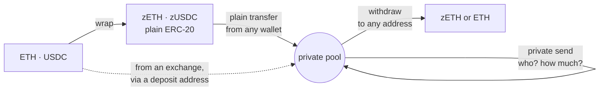

<div align="center">


# zERC20

### ERC20 with privacy

**Privacy with the best compatibility there is:<br/>a plain ERC-20 that every wallet and dApp already works with.**


</div>

---

## Just an ERC-20

Wrap ETH and get **zETH**. Wrap USDC and get **zUSDC**. Unwrap and get it all back, 1:1.

A z token is an ordinary ERC-20: no new standard, no adapter, no special wallet to hold it. Every wallet shows it, every
explorer reads it, and every dApp that takes ERC-20 takes it. It signs ERC-2612 permits and ERC-3009 transfers with
authorization too, the way x402 pays.

## Privacy is one transfer away

A deposit is a plain transfer to a **burn address**: an address made from your wallet's secret, with no private key
behind it. Any wallet that can send a token can deposit, and on chain it looks exactly like paying an account nobody
has seen before. Only you can later prove, in zero knowledge, that it was yours.

Inside the private pool, z tokens are coins that are only hashes on chain: no owner, no amount. Send them, split them,
and withdraw them to any address, as zETH or as ETH itself. Nothing on chain links the payer to the payee, and what
comes out is a plain token again, ready for any dApp.



## Under the hood

- **Circom + Groth16** for the proofs a phone makes: private sends and refunds.
- **Nova folding** for the big ones: the commitment tree's roots and merges of many coins into one.
- **One Rust core** for the protocol's math, shared by the circuits, the attester and the wallet (compiled to wasm), so the
  wallet cannot drift from what the attester accepts.
- **Internet Computer + vetKD** to deliver each payment's secrets to its receiver, encrypted, with an audit log anyone can
  check.
- **Lean 4** for machine-checked proofs, down to every circuit constraint, that nobody can take what is yours and that
  you can always get it out.

## Run it locally

Needs Rust, Node 22, Foundry, circom, wasm-pack, Docker, jq and psql.

**1. Build once:** the SDKs, the storage canister, the contracts' dependencies and the proving keys.

```sh
(cd storage/sdk && npm ci && npm run build)
(cd wallet/sdk && npm ci && npm run build)
(cd storage && cargo build --release --target wasm32-unknown-unknown -p zerc20_storage)
(cd contracts && forge soldeer install)
(cd zkp && npm ci && npm run artifacts:setup -- root joinsplit rageexit)
```

**2. Start the stack:** a local chain with zETH and zUSDC, every node, and funded test accounts, until Ctrl-C.

```sh
SPEED=fast FUND=0xYourBrowserWallet scripts/dev-stack.sh
```

`SPEED=fast` lands roots and merges in seconds; the proofs a wallet makes stay real. `FUND` gives that address
10000 ETH.

**3. Open a wallet** in another terminal: a page over the SDK, with every action open, on the stack just started.

```sh
cd wallet/sdk && npm run demo    # http://localhost:5173
```

It signs with the stack's test keys, or with your browser wallet once it has the local chain: `http://127.0.0.1:8545`,
chain id 31337.

## License

`zkp/` and `backend/attester/proto/` are under the AGPL-3.0 in [LICENSE](LICENSE). The nodes in `backend/` are built on
them, and are under the Business Source License in [backend/LICENSE](backend/LICENSE).

As an additional permission under section 7 of the AGPL, you may combine `zkp/` and `backend/attester/proto/` with the
nodes in `backend/`, in source or object form, and convey the result under the terms `backend/LICENSE` gives for the
nodes.
