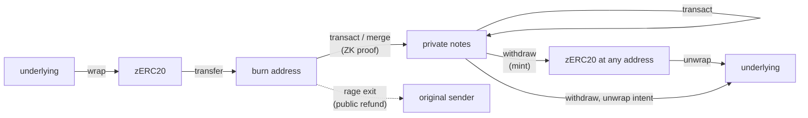
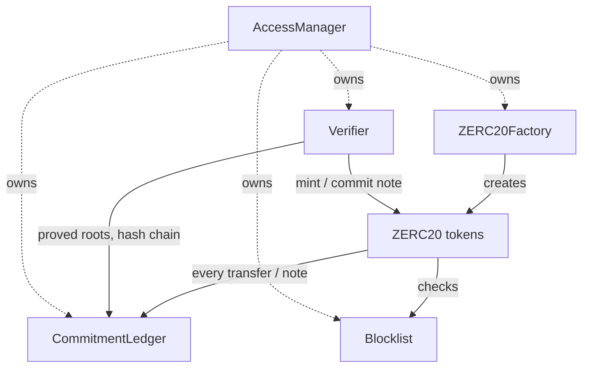

# zERC20 contracts

zERC20 wraps an ERC-20 (or the native asset) 1:1 into a token that behaves like any other ERC-20,
and adds a private pool on top of it. Every transfer of the token is also recorded in a commitment
tree. A transfer to a **burn address** looks like any other transfer on chain. Later, the owner of
that address can prove in zero knowledge that they own it and move the value into private notes or
withdraw it somewhere else. Nothing on chain links the withdrawal back to the deposit.

## How value moves



- **Burn address**: an address derived from a secret key and a salt. No private key exists for it,
  so tokens sent there are out of circulation. Only the holder of the secret can claim them, and only
  through a proof.
- **Note**: a private balance. On chain it is just a hash. Spending a note reveals its
  **nullifier**, which can only be spent once, but does not reveal which note it was.
- **Withdrawal**: a public mint of zERC20 to any recipient, authorized by a proof that spends
  inputs of the same total value. The proof also binds a **withdraw intent** that says how it is paid
  out: 0 mints zERC20, and `Protocol.UNWRAP_INTENT` pays the underlying asset instead, so a fresh
  recipient needs no gas to unwrap. Any other intent is rejected.

## Contracts



| Contract                                  | Role                                                                                                                                                                                                                                                                                                                              |
| ----------------------------------------- | --------------------------------------------------------------------------------------------------------------------------------------------------------------------------------------------------------------------------------------------------------------------------------------------------------------------------------- |
| `ZERC20`                                  | The token. `wrap` / `unwrap` against the underlying. Every transfer between two real accounts is appended to the ledger. Only the Verifier can pay out withdrawals (minted, or as the underlying) or append note hashes. ERC-2612 permits and ERC-3009 transfers with authorization (how x402 pays) go through the same transfer. |
| `ZERC20Factory`                           | Creates one token per underlying asset and is the source of truth for `tokenId -> token`.                                                                                                                                                                                                                                         |
| `CommitmentLedger`                        | Append-only stream of commitments under a SHA-256 hash chain, plus the registry of commitment-tree roots proven to follow from it.                                                                                                                                                                                                |
| `Verifier`                                | Entry point of the private pool: `transact`, `merge` and `rageExit`. Keeps the nullifier set, accepted ASP roots, attesters, withdrawal fees and pause switches.                                                                                                                                                                  |
| `Blocklist`                               | Sanctions list shared by every token.                                                                                                                                                                                                                                                                                             |
| `AccessManager`                           | OpenZeppelin's, not upgradeable. Owns the protocol contracts and decides, by role, who may call which function after what delay.                                                                                                                                                                                                  |
| `DepositAddress`, `DepositAddressFactory` | Counterfactual deposit addresses that turn a plain transfer into a burn deposit.                                                                                                                                                                                                                                                  |

`libs/Protocol.sol` holds the constants shared with the circuits. `verifiers/generated/` is generated
from `zkp/`. Do not edit it by hand.

## Token names

A token is named `zERC20 <underlying's name>`, with the symbol `z<underlying's symbol>`: USDC
(`USD Coin`, `USDC`) becomes `zERC20 USD Coin`, `zUSDC`, and Ether `zERC20 Ether`, `zETH`.

The prefix is what keeps wallets quiet. Wallets run every transaction through a security scanner
(MetaMask through Blockaid), and the scanner marks a token whose name is a near copy of a widely
held asset's, such as `zUSD Coin`, as an impersonator. The token's address is then shown as
malicious on every approve and wrap. The symbol alone does not trigger it.

The factory takes names verbatim, so every `createToken` and `setTokenMetadata` follows this rule.
`script/Deploy.s.sol` applies it, and so must whatever makes a token later. After making a token,
check that the scanner does not mark its address malicious before users see it. A token's name is
also its EIP-712 domain name, so a rename voids every outstanding permit and ERC-3009 authorization.

## The ledger and the commitment tree

The ledger records two kinds of commitments, in one sequence across all tokens:

- `Transfer(from, to, amount)`: appended by a token for every transfer between two real accounts.
  Mints and burns are not commitments, so `wrap` and withdrawals add nothing by themselves.
- `NoteHash(hash)`: appended for each private output note.

On chain the ledger only maintains a SHA-256 hash chain over these commitments, which is cheap to
extend. The Poseidon Merkle tree that the circuits use is built off chain. Anyone can advance the
on-chain root with a Nova proof that the new root is exactly the old tree plus the commitments
between two points of the hash chain. Proved roots stay valid, so a proof may refer to any of them,
unless an emergency bounds them or a recovery withdraws them (below).

Checkpoints pin the hash chain at a given index. They are permissionless, because they only store
values that are already canonical. Root proofs and rage exits both end at a checkpoint.

## Private operations

|                                   | `transact`                                | `merge`                                     | `rageExit`                            |
| --------------------------------- | ----------------------------------------- | ------------------------------------------- | ------------------------------------- |
| Spends                            | 1 or 2 inputs, at most one a burn deposit | N notes or burn deposits                    | one burn deposit                      |
| Produces                          | 2 notes + optional public withdrawal      | 1 note + optional public fee to the relayer | public refund to the deposit's sender |
| Proof                             | Groth16 (JoinSplit)                       | Nova (folding)                              | Groth16 (RageExit)                    |
| Needs a proved root               | yes                                       | yes                                         | no, walks the hash chain              |
| Burn deposits screened by the ASP | yes                                       | yes                                         | no                                    |
| Needs an attester signature       | yes                                       | yes                                         | no                                    |

`rageExit` is the escape hatch. If a deposit cannot pass the ASP, or root proofs stop, the owner of
the burn address can still get the funds back, but only publicly and only to the original sender.
It derives the same nullifier as a private spend, so a deposit is either spent privately or
refunded, never both.

## Safety layers

- **ASP (Association Set Provider)**: a burn deposit enters the private pool only if the ASP has
  approved that deposit, by its commitment index, in a set it published. The ASP screens the
  deposit's sender after the deposit, so an approval never carries over to a later deposit from
  the same sender.
- **Attesters**: `transact` and `merge` also need an EIP-712 signature over the same public
  statement from an allowed attester, meant to be a TEE that re-checks the witness. A soundness bug
  in a circuit is therefore not enough on its own to move funds.
- **Blocklist**: a blocked account cannot send, receive, wrap or unwrap. A `transferFrom` spender is
  checked too. A relayer of an ERC-3009 transfer is not, since it cannot change what was signed.
- **Pause**: the Verifier can stop everything globally or for a single token: private operations,
  and on the token itself wraps, unwraps, transfers and fee claims. Rage exits stop too, so it is not
  the answer to a forged root.

## Emergency and recovery

A soundness bug in the root circuit lets anyone prove a forged root, one over leaves that are not
in the ledger. The attester never signs for it, since the indexer derives every root itself. But
nothing can be proved on top of a forged root, and on chain it looks like any other.

- **`enterEmergency(bound)`**: the ledger proves no root, and accepts none above `bound`.
  - A guardian (the root-prover and the sentinel, each watching an indexer) or a pauser may call it.
  - It only lowers the bound, so it needs no delay.
  - Spends under roots up to the bound go on, and so do rage exits.
- **`recover(index, root, verifier)`**: the admin, through its delay, ends the emergency.
  - The ledger restarts from a proved root, with a new root verifier. A new verifier must reject an
    empty proof, so an address that returns for any call cannot be set by mistake.
  - Every root proved in this era above `index` is withdrawn for good.
  - Each recovery starts a new era. A past era's roots stay accepted up to the index its recovery
    restarted from, so a second incident leaves the first one's settlement standing. A recovery
    therefore cannot restart below the previous one.
- `provedRoots` says whether a proof may use a root now, so the Verifier needs no change.
  `provedIn` says whether this chain proved the root at all.

The emergency is entered on the indexer's word, not on a proof. Any proof would go through the same
broken verifier: someone with the bug could prove a "conflicting" root from genesis, and so freeze
every note. The root-prover trusts the indexer the way the attester does. Its account can only stop
the system, never resume it.

## Governance and upgrades

The `AccessManager` owns every proxy. Calls go through `AccessManager.execute(target, data)`, which
checks the caller's role for that function:

| Role         | Id  | May call                                                                                                                                                                                                                                                                | Delay                                                              |
| ------------ | --- | ----------------------------------------------------------------------------------------------------------------------------------------------------------------------------------------------------------------------------------------------------------------------- | ------------------------------------------------------------------ |
| `ADMIN_ROLE` | 0   | Every function not assigned below: upgrades, `upgradeTokenBeacon`, `recover`, `unpause`, `unpauseToken`, `addAttester`, `setAspPublisher`, `setJoinSplitVerifier`, `setRageExitVerifier`, `setMergeVerifier`, `transferOwnership`, and every role or assignment change. | Per member: none in development, a multisig's delay in production. |
| `OPERATOR`   | 1   | `setFee`, `createToken`, `setTokenMetadata`, `setBlocked`, `setGuardian`.                                                                                                                                                                                               | None.                                                              |
| `PAUSER`     | 2   | `pause`, `pauseToken`, `enterEmergency`, `revokeAspPublisher`, `revokeAttester`.                                                                                                                                                                                        | None.                                                              |

- The operator cannot upgrade, resume or move funds. A fee tier is capped at 3%
  (`FeeSchedule.MAX_FEE_BPS`), and only an upgrade can raise the cap.
- A broken circuit or a leaked setup: the pauser pauses at once, and the admin swaps that proof's
  verifier (`setJoinSplitVerifier`, `setRageExitVerifier`, `setMergeVerifier`), then resumes. A replacement takes the same public signals, and must reject an empty proof, so that an
  address answering every call cannot be put in. The root verifier is swapped by `recover`.
- The pauser stops; only the admin resumes. Against a leaked ASP or attester key, the pauser
  revokes it at once: `revokeAspPublisher` drops every ASP root, which stops transact and merge but
  leaves rage exits, wraps, unwraps and transfers open. Naming a new one is the admin's.
- A member with a delay `schedule`s a call and `execute`s it once the delay has passed, within a
  week, after which it expires. Without a delay, `execute` runs the call at once. Lowering a member's
  delay takes effect only after the difference.
- `Deploy` gives the broadcaster all three roles with no delay. To hand over, `grantRole` to the new
  members, check that each can act, then `renounceRole` the broadcaster's three roles.
- The manager cannot be upgraded. To replace it, the old one calls `transferOwnership(new)` on each
  of the five proxies, and the new one calls `acceptOwnership` on each.
- Core contracts are UUPS proxies with ERC-7201 namespaced storage. Tokens are beacon proxies, so
  the factory upgrades all of them at once.
- A deposit address is an immutable clone. Its funds can only go to its burn address, its fee
  recipient (the fixed fee alone), its referrer (its fixed share alone) or back as a refund: to its
  refund address, or where its refund signer signs for.

## Deposit addresses

A deposit address lets a user make a burn deposit with nothing more than a plain transfer, for
example a withdrawal from an exchange. Its address is computed in advance from
`(token, burnAddress, refundAddress, refundSigner, feeRecipient, fee, referrer, referralBps)`. After funds arrive,
anyone (typically a relayer) calls `DepositAddressFactory.flush`, which deploys the clone if needed,
pays `fee` to `feeRecipient` and `referralBps` of the rest to `referrer`, and wraps what remains
into the burn address. A balance that does not exceed the fee cannot be flushed.

- The referrer is the app that handed the address out, so any frontend can earn from the deposits it
  brings without running a relayer. It sets its own rate on top of the relayer's fee, so referring
  itself gains nothing and anyone may be one. The factory caps the rate at 3%, which bounds what a
  user of any frontend can lose to it. The referrer is its payout address, so it needs no registry,
  and `DepositAddressCreated` indexes it.

- A rage exit refunds to the deposit address, which sends it on, as anything else it cannot wrap.
  It names one of two: a refund address, which anyone may `refund(asset)` to, for a payer with no
  key (one paying from an exchange); or a refund signer, a key of the wallet's own, whose signature
  picks the destination when refunding (`refundTo`). With a signer, the wallet's account appears
  nowhere in the address, so the deposit ties to it only once it is refunded; the signature covers
  the chain and the address, so it moves nothing at the same address on another chain. Underlying
  that a flush can still take is flushed instead: a refund never undoes a deposit.

- The factory's proxy sits at an address derived from its implementation, which holds the clone's
  code, so a changed clone gets a factory of its own (`script/SwapDepositAddressFactory.s.sol`). The
  one before stays, serving the addresses it derived: changing its clone in place would derive them
  anew and strand what was sent to them.

## Development

```sh
forge soldeer install   # dependencies/ from foundry.toml, pinned by soldeer.lock
forge build
forge test
```

## Deploy

`script/Deploy.s.sol` deploys everything through the CREATE3 factory at
`0x29C85935D4D627d9544Ea4C7fdca9b4c547B281d` (on Sepolia, Base/Arbitrum Sepolia, Polygon Amoy, BNB
testnet, Kairos and others).

```sh
# fresh anvil node only: put the CREATE3 factory in place once
forge script script/Deploy.s.sol --sig "bootstrapAnvil()" --rpc-url $RPC_URL

forge script script/Deploy.s.sol --rpc-url $RPC_URL --broadcast --private-key $PRIVATE_KEY
```

| Variable        | Default                    | Meaning                                                                       |
| --------------- | -------------------------- | ----------------------------------------------------------------------------- |
| `DEPLOY_SALT`   | `zerc20.dev`               | Instance name. Proxy addresses derive from it; a used salt reverts.           |
| `ASP_PUBLISHER` | broadcaster, on anvil only | The only account that may publish ASP roots. Required elsewhere.              |
| `ATTESTERS`     | broadcaster, on anvil only | Comma-separated attester addresses. Required elsewhere.                       |
| `DUMMY_USDC`    | `false`                    | Also list a DummyUSDC anyone may mint, as zUSDC. Anvil and the testnets only. |

- Verifiers and implementations sit at addresses derived from their code, so unchanged ones (above
  all the Nova deciders) are reused, also by a new `DEPLOY_SALT`.
- The broadcaster holds every role with no delay. The script creates zETH and registers the attesters
  through the `AccessManager`.
- A broadcast writes every address to `deployments/<chainId>.json`.
