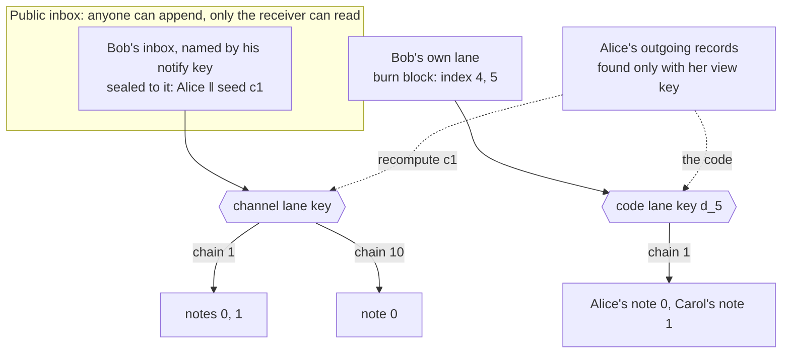

# zerc20-storage

Private note delivery for zERC20 on the Internet Computer.

A zERC20 payment creates a note on chain. To find and later spend it, the receiver needs the note's
opening: its value, salt and so on. This repository delivers that opening privately. The payer
leaves it, encrypted, in an ICP canister, and the receiver finds it with its view key. The canister
holds only ciphertext under unlinkable ids, so it cannot tell who paid whom. The design follows the
note delivery of Starknet's privacy pool
([starkware-libs/starknet-privacy](https://github.com/starkware-libs/starknet-privacy)).

- **`canister/`** (`zerc20_storage`): a write-once ciphertext store, a directory of what payers need
  to pay an address, and a vetKD gateway that opens escrowed view keys for the auditor and logs
  every audit.
- **`sdk/`** (`@zerc20/storage-sdk`): a TypeScript SDK that holds every secret. It derives keys and
  ids, encrypts, plans payments and keeps each user's history in sync.

## How it works

**View keys.** Every address has one view key per canister, derived from the root seed of its zERC20
private identity and the canister's id. A device holding that seed restores it with nothing from the
canister. A testnet and mainnet share root seeds, so the id keeps a key escrowed in one canister from
opening anything in another.

**Registration.** Before it can be paid privately, an address registers, with one wallet signature
(EIP-191) over:

- its zERC20 `public_key`, one for every chain and token, which the notes paid to it are owned by;
- a _notify key_ (X25519, derived from the view key), which payers encrypt channel announcements to.
  It names the registration: another root seed has another one;
- an _escrow_: the view key, IBE-encrypted to `address ‖ notify_key` under the canister's _escrow
  public key_. Only vetKD can derive the key that opens it, and only for the auditor (see Audit).

Payers check the owner's signature themselves, so the canister cannot point them at keys of its own.
An address that never registered cannot be paid privately: pay it publicly, or ask for a receive
code.

- Opening a wallet again, on any device, reads the registration with a query, which one replica
  answers. Only a missing or foreign one is confirmed with an update call before the wallet registers
  or stops: logging in costs no update call.
- A later registration, from another root seed, replaces the current one if it expires later, so an
  old signature cannot be replayed over a newer one. The replaced one stays, for audits.

**Lanes.** Records live in lanes, each a sequence of 256-byte slots per chain. A lane's key derives
its slot ids and the key its slots are sealed under, the same way for every lane. There are four
kinds:

- a **channel**, from one payer to one address;
- a **receive code's** lane, which every payer of the code writes to;
- a **point of sale's** lane, which that point of sale alone writes to, with a key the owner handed it;
- the **own** lane, which only the owner's devices write and read: notes to self, burn blocks and points of
  sale.

Readers scan each lane on each chain they watch from slot 0 up to the first empty slot.

**Inboxes and channels.**

- An **inbox** is a public list of channel announcements. Each registration has one, named by its
  notify key.
- A **channel** is opened once per payer and inbox. Its announcement, encrypted to the receiver,
  carries the payer's address and a channel seed. The channel's lane key derives from that seed,
  bound to the inbox and the claimed payer.

Discovery cost grows only with the receiver's own activity: one pass over its inbox, then over the
channels that decrypt.

**Three ways to pay.**

- **To an address.** The payer looks up the receiver's registration (`lookupRecipient`), encrypts
  the announcement to the notify key, writes a note to the channel (`planSend`), and creates the
  on-chain note for that `public_key`.
- **To an address, by a deposit.** The payer looks the receiver up the same way, and picks a salt
  whose burn address under the receiver's `public_key` has the proof of work (zERC20-v2's
  `burn_address`, about 2^16 tries). It tells the salt in the channel (`planDeposit`), then pays the
  burn address from its public balance by a plain transfer, which the receiver finds and spends as a
  deposit of its own. Only the two know the salt, so the address names no one.
- **To a receive code.** The receiver hands out a code over a trusted channel. It works for an address
  that never registered, and names neither the receiver nor its `public_key`.
  - A code is one of the wallet's own burn indices `i` (see Burn blocks). It carries the
    chain, token, the burn address of `i`, a `public_key` of its own (zERC20-v2's
    `keys::code_spend_secret(seed, chain, token, i)`), and its lane key `d_i`.
  - It takes any amount, any number of times: by a plain transfer to the burn address (a deposit), or
    by a note owned by the code's `public_key`. The payer writes that note to the code's lane, naming
    itself, and records the code in its outgoing records the first time. Every payer of the code
    writes to the same lane, after the notes already there.
  - The receiver needs no inbox and no backup: the burn block that recorded `i` is the backup, and the
    code's lane is found through the log like any other. Handing a code out writes nothing.

**Notes to self.** A merge output, or the change of a payment, goes to the owner's own lane with its
receipt: what the payment or merge was, whom it paid, how much, and the fee.
It needs no channel and no announcement, and no receiver can read it. What leaves no note to self (a
deposit returned by rage exit, a deposit address registered) goes there as an own receipt.

**Burn blocks.** A burn address (zERC20-v2's `keys::derive_burn_address`, from a burn key) is paid by a
plain transfer, with nothing written here. So whoever hands one out first records it in a burn block
(`planBurnBlock`): the salts of 1 to 6 consecutive indices. Every device of the owner, and a restore,
then watches the block's addresses and never hands them out again.

- The wallet records its own in the own lane, one to a block, from index 0 up, each also a receive
  code. It keeps one recorded ahead for each token it has handed one out for, so that handing it out
  writes nothing: the time of the write would otherwise mark the first payment to it. A token's first
  is recorded as it is handed out.
- A point of sale records its own in its lane, 6 to a block and up to 16 blocks in one write.
- Salts, not indices: an address takes about 2^16 hashes to derive from its index, and one to check
  from its salt.

**Points of sale.** A point of sale (a checkout server, say) hands out the owner's payment addresses with no key
that spends, and makes them itself.

- The owner records point of sale `n` in its own lane (`planPosLane`) and hands its lane key `KDF(s, "pos", n)`
  (`posKey`) to that point of sale alone. Two holding one key would hand out the same addresses.
- The point of sale's `k`-th address of a chain and token is zERC20-v2's
  `keys::derive_burn_address(lane key, chain, token, k, public_key)`, under the `public_key` the owner registered, as
  the owner's own are under its `burnKey`. The point of sale records the salts in its lane as burn blocks whose
  `first` is `k` (`writePosBlocks`), ahead of need like the owner's, and is paid by deposit only.
- Every device of the owner finds the lane through the own lane and watches its addresses. The lane key derives from
  the view key, so the owner can derive every address again without the point of sale or its records.
- The key opens that lane and nothing else: whoever holds it sees the point of sale's addresses and can write
  records there, and spends nothing.

**History.** From the view key alone, `refresh` recovers everything you sent, everything you
received, your notes to self, your burn blocks and your points of sale's. Both sides see the same notes. For a code payment,
the receiver sees which code was paid and the payer each note names, and the payer the code; each
payer finds only its own notes.



## Records

Every blob the canister stores is exactly 256 bytes, so its length tells nothing of what it holds:

- a slot is `nonce(12) ‖ ChaCha20-Poly1305(plaintext, 228 bytes) ‖ tag(16)`, with its id as
  associated data;
- an inbox announcement is `ephemeral_key(32) ‖ nonce(12) ‖ ciphertext(196) ‖ tag(16)`, ECIES to the
  notify key, with the inbox as associated data.

A plaintext is `type(1) ‖ body ‖ zeros`. Integers are big-endian. A value has 31 bytes, so it is
below 2^248; a salt must be below Fr.

### Record types

| type   | record             | body                                                                                   | where                           |
| ------ | ------------------ | -------------------------------------------------------------------------------------- | ------------------------------- |
| `0x01` | note               | `token_id(4) ‖ value(31) ‖ note_salt(32)`                                              | channels                        |
| `0x02` | note to a code     | a note's body `‖ payer(20)`, as claimed                                                | code lanes                      |
| `0x03` | note to self       | a note's body `‖ receipt(83)`                                                          | the own lane                    |
| `0x04` | deposit            | `token_id(4) ‖ value(31) ‖ burn_salt(32) ‖ burn_address(20)`                           | channels                        |
| `0x05` | burn block         | `token_id(4) ‖ first(4) ‖ count(1) ‖ salt(32) × count`, 1 to 6 salts                   | the own and point of sale lanes |
| `0x06` | returned           | `token_id(4) ‖ burn_address(20) ‖ index(8) ‖ recipient(20) ‖ amount(31) ‖ tx_hash(32)` | the own lane                    |
| `0x07` | deposit address    | `token_id(4) ‖ burn_address(20) ‖ deposit_address(20) ‖ 1 ‖ args`                      | the own lane                    |
| `0x08` | point of sale      | `n(4)`                                                                                 | the own lane                    |
| `0x10` | sent to an address | `address(20) ‖ notify_key(32)`                                                         | outgoing records                |
| `0x11` | sent to a code     | the code's body                                                                        | outgoing records                |
| `0x20` | channel            | `payer(20) ‖ channel_seed(32)`                                                         | inbox announcements             |
| `0x30` | passkey seed       | `seed(32)`                                                                             | passkey seed slots              |
| `0x40` | receive code       | `chain_id(8) ‖ token_id(4) ‖ burn_address(20) ‖ public_key(32) ‖ key(32)`              | text, below                     |

- A deposit's `burn_address` is the receiver's to derive. The payer's other devices find the transfer
  by it.
- A passkey seed is the root seed of an account restored from its recovery phrase, kept for the passkey
  made for it. That passkey's PRF output is not the seed, so it seals the seed here, and opens it on
  every device the passkey syncs to. A reader takes the last one that opens, so a later version
  appends rather than rewrites.
- A returned record says that a rage exit sent the deposit at commitment `index` of `burn_address`
  back to `recipient`. A deposit address record says that `deposit_address` was registered to forward
  into `burn_address`. Neither leaves a note to self, so these keep them for every device of the
  owner.
- A deposit address's `args` are, with its token and burn address, all the factory derives it from
  (an owner's refund address is zero), so its owner flushes it without the relayer that registered it:
  `fee(31) ‖ fee_recipient(20) ‖ refund_signer(20) ‖ referrer(20) ‖ referral_bps(2)`. Zeros in place
  of `1 ‖ args` leave them untold.

### Receipts

A note to self's receipt, `kind(1) ‖ amount(31) ‖ fee(31) ‖ counterparty(20)`, says what it is the
change or the output of, so that every device of the owner shows it once the note lands. `amount` is
what was paid, withdrawn, or merged into the note, and `fee` what it cost on top: the relayer's fee
and the protocol's cut.

| kind | what                              | counterparty            |
| ---- | --------------------------------- | ----------------------- |
| `1`  | sent to an address                | the address             |
| `2`  | sent to a receive code            | the code's burn address |
| `3`  | withdrawn                         | the recipient           |
| `4`  | withdrawn as the underlying asset | the recipient           |
| `5`  | merged                            | 20 zero bytes           |

### Reading them

- A note opens zERC20-v2's `note_hash = Poseidon(chain_id, public_key, value, token_id, note_salt)`.
  Its chain is the slot's (it is part of the slot id), and its owner's `public_key` the one the payer
  looked up.
- A reader takes a record's body and ignores what follows it. A later version appends fields that an
  older reader passes over, and gives a record an older reader must not misread a new type.
- A reader drops a slot that does not open, holds a type it does not know or that does not belong in
  its lane, or holds a salt not below Fr. A note in an outgoing code lane counts only if it names the
  reader as its payer.
- A receipt of a kind the reader does not know is passed over, and its note kept: it may be
  spendable change.
- The canister stamps every slot with the time it was first written (`Slot.at_ns`).

A receive code is handed out as text: bech32m with prefix `zerc20` of `0x40 ‖ body` (`encodeCode`),
about 169 characters, so a mistyped one fails its checksum instead of paying someone else.

## Using the SDK

```ts
import { HttpAgent } from '@icp-sdk/core/agent';
import {
  CanisterClient,
  commit,
  emptyState,
  exportState,
  importState,
  lookupRecipient,
  planSend,
  refresh,
  registeredViewKey,
} from '@zerc20/storage-sdk';

const client = new CanisterClient(await HttpAgent.create({ host: 'https://icp-api.io' }), canisterId);
// `rootSeed` is the zERC20 wallet's root seed and `publicKey` its zERC20 public key. `sign` is the wallet's EIP-191
// personal_sign, returning r ‖ s ‖ v; it is needed only to register.
const view = await registeredViewKey(client, rootSeed, sign, address, publicKey);
let state = (saved && importState(view, saved)) ?? emptyState(view, [1n, 10n]); // the chains to watch

// Poll: each refresh reads only what is new and returns the records it found.
const { state: next, added } = await refresh(client, view, state);
saved = exportState(view, (state = next)); // encrypted bytes; store them anywhere

// Pay: write the note here, then create the on-chain note with the same opening, owned by
// recipient.publicKey.
const recipient = await lookupRecipient(client, to); // null: never registered
({ state } = await commit(client, view, state, (s) => planSend(view, s, recipient, opening)));
```

**Polling.** Every list in the canister is append-only or write-once, so the state remembers how far
each one has been read.

- New records are found through the canister's log of lane slot ids, in write order. A refresh reads
  the log from where it stopped and matches the next slot id of each of its lanes against it, then
  reads only the lanes with news. Its cost does not grow with the number of channels, and it asks for
  no slot id that is not its own news, so a replica cannot tie a reader's channels together.
- A refresh with nothing new makes queries only: one for outgoing records, one for the address inbox,
  and one for the log. It reads the own lane first, so that the codes of a new burn block, and a new
  point of sale's lane, are read in the same refresh.
- Queries come from a single replica, so they only spot news. Whatever the state keeps is read again
  with update calls. A replica that leaves log entries out only delays records: a `full` refresh reads
  every lane (one query per 256 of them), as the first refresh of a state does. Do one now and then,
  say hourly.
- A code is never closed: like its burn address, it can be paid again any time.

## Paying correctly

1. **Write the note here first**, then create the on-chain note with the same opening. A note that
   exists only on chain cannot be found.
2. **If a submit's outcome is unknown, resubmit the exact same actions.** Writes are write-once and
   batches are atomic, so a repeat changes nothing. Plan again only after `Occupied` or a definite
   rejection. `commit` does both: it resubmits after an unknown outcome, and after `Occupied`
   (another device, or another payer of the same code, wrote first) it refreshes and plans once more.
3. **Record every note to self the same way.** Put a payment's change, with the payment's receipt, in
   the payment's batch (`planSelf`), so both are written or neither. Record a merge output before its
   transact. Write a zero-value change too: no one can spend it, but its receipt is how every device
   of the owner shows the payment once the change lands.
4. **Match notes to on-chain leaves one-to-one** by `commitment_index`, across all lanes. Treat
   unmatched notes as pending: a note to self from a transact that was never sent stays unmatched. Use
   a fresh `note_salt` for every note.

## Registering anew and audit

**Registering anew.**

- `register` replaces an address's registration. It needs the owner's signature, and it must expire
  later than the current one, so a signature cannot be replayed.
- Payers look up the registration, an update call, before every payment. New payments therefore go to
  the new registration's inbox, in fresh channels that the old key cannot read.
- `registeredViewKey` with another root seed than the registered one throws rather than replace it.

**Audit.**

- One auditor, a principal, can open the escrow of any registration, current or replaced: vetKD
  derives the key to it (`audit_escrow_key`), encrypted to a transport key of the auditor's, and
  `openEscrow` yields the view key.
- The auditor is an Orbit station, so its members approve each request under its policy. The station
  shows them what a request opens with `validate_audit_escrow_key`, and executes each approved one
  once, so requests need no expiry or replay guard.
- Every request is appended to a public log _before_ the key is derived. `get_audits` returns the log,
  each record naming the auditor that made it.
- The canister cannot check what an escrow holds. A wallet that escrows something else cannot be
  audited, so audits rely on honest wallets.

## Keys and ids

`KDF(key, label, parts)` is HKDF-SHA256 with salt `zerc20/storage/kdf/v1`, and info the label and
parts, each prefixed with its length (u32, big-endian). `H(tag, parts)` is SHA-256 of the same framing,
for what anyone can compute.

| Value                         | Derivation                                                                                                    |
| ----------------------------- | ------------------------------------------------------------------------------------------------------------- |
| view key (seed) `s`           | `KDF(root_seed, "view", address ‖ canister_id)`                                                               |
| notify key                    | X25519 secret `KDF(s, "notify")`                                                                              |
| escrow                        | IBE to `address ‖ notify_key` (vetKD context `zerc20/storage/escrow/v1`) of `s`                               |
| address inbox                 | `H("zerc20/storage/inbox/v1", address, notify_key)`; announcements ECIES (label `announce`) to the notify key |
| channel seed `c`              | `KDF(s_payer, "channel", payer ‖ inbox)`                                                                      |
| channel lane key              | `KDF(c, "channel-key", inbox ‖ claimed payer)`                                                                |
| code lane key `d_i`           | `KDF(s, "code", chain_id ‖ token_id ‖ i)`                                                                     |
| own lane key                  | `KDF(s, "own")`                                                                                               |
| point of sale `n`'s lane key  | `KDF(s, "pos", n)`                                                                                            |
| slot `i` of a lane on a chain | `KDF(lane_key, "slot", chain_id ‖ i)`, sealed under `KDF(lane_key, "seal")`                                   |
| outgoing record `j`           | `KDF(s_payer, "outgoing-id", j)`, sealed under `KDF(s_payer, "outgoing")`                                     |
| passkey seed slot `i`         | `KDF(prf, "passkey-seed-id", canister_id ‖ i)`, sealed under `KDF(prf, "passkey-seed", canister_id)`          |
| exported sync state           | sealed under `KDF(s, "sync-state")`, with `zerc20/storage/sync-state/v1 ‖ address` as associated data         |

The owner signs `zERC20 storage registration`, followed by what it covers and a last line
`tag: zerc20/storage/registration/v1`. A registration's proof-of-work digest is
`H("zerc20/storage/registration/v1", address, public_key, notify_key, escrow, expiry_ns)`.

## Spam controls

Callers may be anonymous, so abuse is limited by cost and by rate.

- **Proof of work.** Writes need 14 bits, or 17 when a batch opens a channel. `register` needs 18:
  `SHA-256("zerc20/storage/pow/v1" ‖ digest ‖ nonce)` must start with that many zero bits. These are
  sized for a five-year-old budget Android phone, whose browser does about 100k hashes a second. On
  it, a write takes ~0.2 s on average, opening a channel ~1.3 s, and registering ~2.6 s.
- **Rates.** At most 32 new channels per inbox per hour, and 28,538 new entries per hour in all, `submit` and
  `register` together. Callers may be anonymous and principals are free, so no cap per caller holds, and work sized
  for a phone costs a GPU next to nothing: the hourly cap is what slows spam that fills the canister for good. At that
  rate the 250M entries below take a year. No audit runs below 1T cycles.
- **Sizes.** Every blob is exactly 256 bytes, a batch at most 16 actions, and a read at most 256 ids.
  The canister holds at most 250M entries in total: the largest entry (a registration that replaces
  another) takes ~858 B of stable memory, so 250M fit 200 GiB of the 256 GiB its memory manager can
  address. Notes, ~480 B each with their log entry, would fill that much in about 120 GB.
  - Full, it costs about 4T cycles per GiB a year in storage (13-node subnet), ~800T cycles a year.
  - It needs a subnet that can hold it.
- **Ingress.** The canister pays for every message it accepts, so `canister_inspect_message` refuses one it has no
  use for: to a method that answers as a query only (`get_log`, `log_length`) or none at all, or with an argument
  larger than any valid one. It runs on one replica and never for calls from canisters, so each method still
  checks its own arguments.

## Canister API

```candid
service : (InitArgs { auditor : principal; vetkd_key_name : text }) -> {
  escrow_public_key : () -> (Result_blob); // update: no single replica answers
  register          : (Registration, nat64 /* pow nonce */) -> (Result);
  registration      : (blob /* address */, opt blob /* notify key, default current */) -> (opt Registration) query;
  audit_escrow_key  : (AuditRequest) -> (Result_blob); // the auditor alone
  validate_audit_escrow_key : (AuditRequest) -> (variant { Ok : text; Err : text }) query;
  get_audits        : (nat64 start, nat32 limit) -> (vec AuditRecord) query;
  submit            : (vec Action, nat64 /* pow nonce */) -> (Result);
  get_announcements : (blob /* inbox */, nat32 start, nat32 limit) -> (vec blob) query;
  get_slots         : (Kind, vec blob) -> (vec opt Slot) query;
  get_log           : (nat64 start, nat32 limit) -> (vec blob) query; // lane slot ids in write order
  log_length        : () -> (nat64) query;
}
```

Payers call `registration` as an update, so that no single replica can answer with a replaced one.
An `Action` either opens a channel (`OpenChannel`) or writes a slot (`Put` a `Lane` slot, or an
`Outgoing` one: a code payment's record, or a passkey seed). Every record of a lane is a `Lane` slot. See
[`canister/zerc20_storage.did`](canister/zerc20_storage.did) for the full interface. An upgrade may
replace the auditor but not the vetKD key name, because a new key would strand every escrow.

## Build and test

```sh
cargo test -p zerc20_storage --lib
cargo build --release --target wasm32-unknown-unknown -p zerc20_storage
cd sdk && npm ci && npm run typecheck && npm test
npm run test:e2e   # PocketIC flows on the release wasm; npm ci fetches PocketIC server 16
```

`sdk/test/vectors.json` pins the owner-only formats (view key, the own lane's notes to self, burn
blocks and points of sale, a point of sale's lane key, proof of work), for any other implementation of the owner's writes to test against.
`UPDATE=1 npm test` rewrites it.

**Browser demo.** `npm run demo` (in `sdk/`, after the wasm build) starts a fresh canister in
PocketIC and serves `sdk/demo/` with Vite. Open the printed URL in a browser with MetaMask, and the
counterparty in a second browser profile. You can send pseudo payments (notes only, no chain), with
change, record merges, record and pay receive codes, and watch both histories update every 3 seconds. Each run
starts from an empty canister.

## Limits

- **Payers are not verified.** A channel or a code's note only _claims_ its payer, so treat the name
  as a hint. A forgery cannot hide a real channel, and a copied seed opens nothing. Amounts are
  confirmed only by the on-chain match.
- **vetKD is trusted for privacy.** The canister's controller, or a threshold of the vetKD subnet, can
  open every escrow, and so read every view key, replaced ones included. An upgrade could also quietly
  stop the audit log. It cannot forge a registration, so it cannot redirect payments.
- **The audit log names the station, not its approvers.** Who approved a request, and the station's
  policy, only its members see.
- **One signature redirects future payments.** Whoever gets the account to sign a registration of
  its own replaces the real one: later private payments go to its keys. What was received already
  stays with the real keys.
- **Registration is public.** It shows that an address uses zERC20, and a lookup shows the canister
  whom a payer is about to pay.
- **Registering anew protects only the future.**
  - The old key keeps reading what it received, and the codes it recorded stay with it.
  - A payment can land in the old inbox if the new registration races it.
  - Replacements are public.
- **Codes need a trusted channel, one payer each.**
  - Swapping the burn address or the `public_key` redirects the funds, and swapping `d_i` the notes.
  - Every payer of a code holds `d_i`: it can read what the others paid privately, and write notes in
    any payer's name. A deposit to the burn address is public, as any deposit is.
  - Two payers paying one code at once can both be `Occupied`; `commit` plans once more, and throws if
    it loses again.
- **Wallets.** Smart-contract wallets cannot register at all. The root seed derives the view key;
  whoever holds it can also spend in zERC20.
- **Assumptions.** Receivers must list the chains they watch. Each chain is assumed to have a single
  zERC20 Factory, since neither notes nor codes name one.
- **Liveness.** Spam can exhaust an inbox's hourly channel limit, or the hourly entry limit, which then refuses
  every new write until the hour ends. One ordinary computer can keep every hour used up for as long as it runs.
- **Out of scope.** Spending and nullifiers, and audit reasons or grants.
